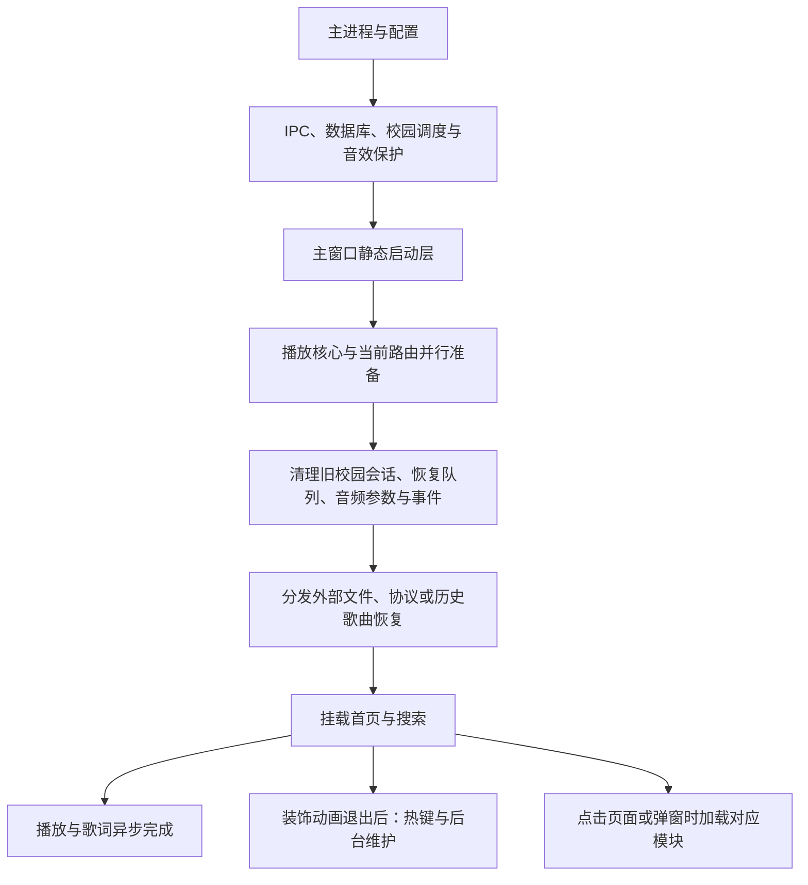

# 启动与按需加载

1.4.0 保证校园闸门、NoiseLimiter 配置与播放器核心优先于音频恢复；搜索与首页在核心可用后开放。音乐来源解析及歌词网络请求不阻塞首屏，也不等待装饰动画。其余页面和弹窗按用户操作加载。

## 启动顺序

原先先挂载首页，再串行等待配置、流媒体配置、校园清理、队列、插件和多次音频参数 IPC；实际恢复歌曲还需等待完整入场与 200 ms 淡出。现在独立任务并行，同一核心初始化共享 Promise；校园清理仍必须在队列恢复之前完成，EQ 参数先于启用，设备选择先于设备独立音量。冷启动外部文件优先于协议，协议优先于历史歌曲。恢复请求先派发，再启动首页非核心数据读取，不等待音源网络完成。

歌词解析与当前歌曲加载属于播放核心，保持优先。在线歌词、封面、TTML 增强异步补充，不使音频等待网络。完整歌词播放页和高开销渲染器仍在首次展开时加载。上次开启的歌词外窗在主窗口显示后逐个恢复，不同时创建全部窗口。

## 按点击加载

路由页面采用动态 import，不预取全部音乐库、统计、B 站等页面。设置保留轻量分类与搜索元数据，自定义配置组件在选中时加载。评论、输出信息、登录、识曲、缩放和歌单工具弹窗首次打开时才下载模块，显示现有设计系统的加载占位；成功后保留必要状态，失败可重试，首次打开即执行所需读取。

缓存和下载服务先完成最小准备与退出接线，旧目录扫描清理移到首屏后的后台任务。维护在项目之间让出事件循环，跳过当前使用的缓存、预载、下载；同名文件屏障防止误删刚启动的下载。Last.fm 首曲回调等待延后载入的凭证，不能丢第一首记录。关闭的 HTTP/MCP 服务不加载 Hono、WebSocket 与路由，启停在途请求可取消。

## 测量与限制

`pnpm audit:startup` 分析实际 `out/renderer/assets` 静态 JS 依赖闭包；动态 import 不算首屏依赖。文件大小是构建后未压缩字节，不代表执行耗时。优化前当前分支测得 bootstrap 6104 字节，main 静态闭包 28 个文件、1518183 字节，MainLayout 闭包 75 文件、2454773 字节；不同闭包共享文件，不能相加。优化后主布局静态闭包约 2251416 字节，减少约 8.3%；主布局自身由 328729 降至 192749 字节，设置搜索模块自身约从 594500 降至 90593 字节。核心 Vue/歌词/播放器与公用 UI 仍必须加载，文件数因拆分反而可能增加。

浏览器记录 `carbonv:bootstrap-start`、`carbonv:player-ready`、`carbonv:app-mounted`、`carbonv:startup-complete`。Windows 便携版验收将实际 performance marks 与资源列表保存到 `startup-acceptance.json`，断言未打开的设置、校园控制中心、插件中心、完整播放页、音乐库、统计和 B 站页面未进入首屏加载集合。此检查同时要求实际播放器核心就绪，不能只展示一个空壳界面。

主进程仍有数据库迁移、轻量 IPC 注册与部分业务静态依赖，插件清单和已安装脚本也需读取。这些不能简单延后并冒险绕过调度、音效保护或破坏首次播放。后续应基于具体低性能 Windows 设备的冷/热启动时长定位，不用打包体积变化推算速度提升比例。
